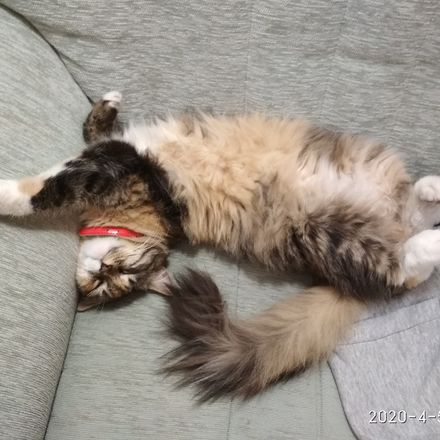

  

  

    

  

    <b>BSc in Computer Science</b> 
    Studying for <b>MSc in Artificial Intelligence & Computer Science</b> (Security) 
    Working as a <b>Software Developer and Security Specialist</b>
  

   

  <h3>My toolbox</h3>

  

    
    
    
    
    
  

  

    
    
    
    
  

   

   

  

<i>A random cat, come back if you want to see a new one :)</i>

   

  

